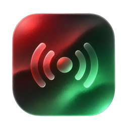

<p align="center"></p>
<h1 align="center">Allradione</h1>
<p align="center">One world. Always on air.</p>

A portable Windows internet-radio player with a tactile tuner, an interactive 3D globe and two always-on-top desktop widgets.

## Download

Download `Allradione-<version>-win-x64.exe` from [Releases](https://github.com/samueltoken/Allradione/releases/latest) and double-click it. No installation, administrator account, VLC or separate runtime is required. Windows 10/11 x64. The ZIP build is an alternative: extract the entire folder and launch `Allradione.exe`.

## Listen

- Drag the globe to rotate, scroll to zoom, then select a country. Country search also works without WebGL.
- Search the station list and choose a stream. Favorites and recent stations stay on your computer.
- Use the tuner or previous/next controls to move between stations. Internet-only stations show `LIVE`; an invented FM frequency is never shown.
- Open **Settings** to enable a **small circular** or **medium retro** desktop widget. Both sit above ordinary application windows at the lower-right of the monitor containing the main window. Closing the main window while a widget is enabled keeps playback running. Reopen it from the widget or tray; use the tray **Quit** item to fully exit.
- The waveform visualizes received audio. It stops when playback stops. Reduced motion is available in Settings.
- In **Settings → Update**, check the latest GitHub release and download/replace the portable executable. The download must pass SHA-256 verification before replacement. Favorites and settings are preserved. ZIP/development builds use the release download page.

## Data and network

Radio Browser supplies the directory. Audio comes directly from the selected station through a loopback proxy inside the app so mixed stream formats and audio visualization work consistently. The proxy is local, random-port and token-protected; it does not relay audio to other listeners. No account, telemetry or application server is required. Selecting a station submits its ID to Radio Browser's public click counter, as requested by their API guidelines.

Portable settings are written to `Allradione-data` beside the original EXE when that folder is writable; otherwise Windows application data is used. Directory metadata is cached for outages. Removing these settings resets favorites and preferences. Web-engine caches may also be stored in the application-data directory.

Availability depends on the station, network and region. Japan and other countries may restrict some domestic services. No region bypass, subscription bypass, recording or redistribution is included. Unsupported formats and connection failures are reported. A normal topmost window cannot cover the Windows secure desktop/UAC screen or guarantee display over every exclusive fullscreen game.

## Develop

Requires Node.js 22+.

```sh
npm ci
npm test
npm run build
npm start
```

For browser-only UI development, `npm run dev` starts Vite. Native widgets and executable updating require Electron. For renderer hot reload, set `ALLRADIONE_DEV_URL=http://localhost:5173` before launching Electron after starting Vite.

```sh
npm run dist:win
```

Build Windows releases on Windows. The GitHub workflows test, bundle the portable EXE and ZIP, and generate `SHA256SUMS.txt`. To release, increment `package.json` and lockfile, commit, then publish a matching `v<version>` GitHub release. The release workflow attaches the binaries automatically. Build failure leaves logs in Actions and must be resolved before distributing the release.

## License

MIT. See [LICENSE](LICENSE) and [THIRD_PARTY_NOTICES.md](THIRD_PARTY_NOTICES.md). Radio station logos and broadcast content retain their original ownership.
