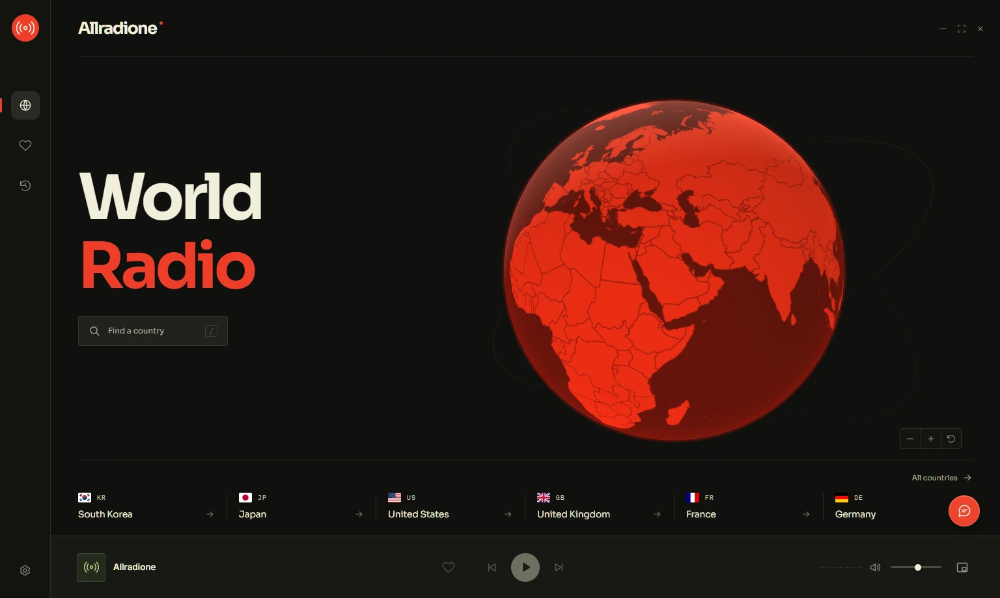
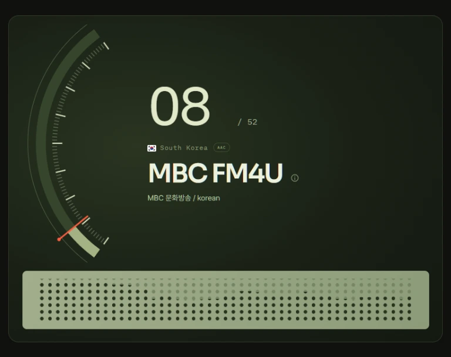
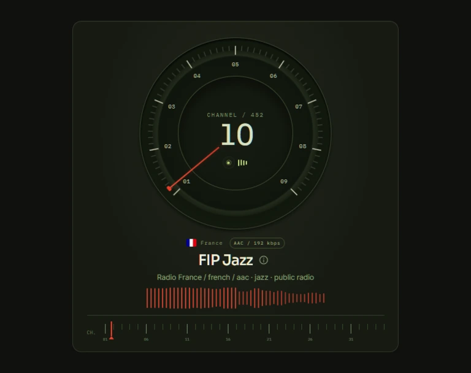
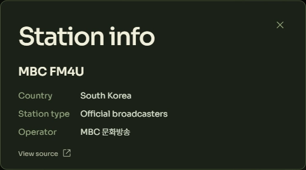
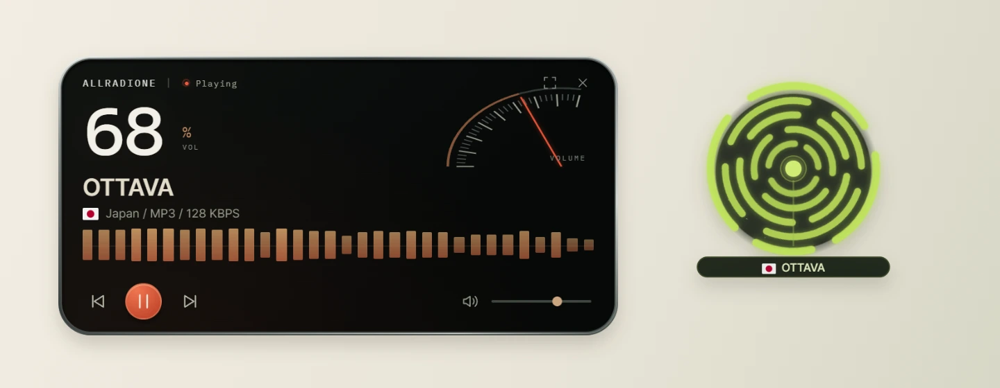
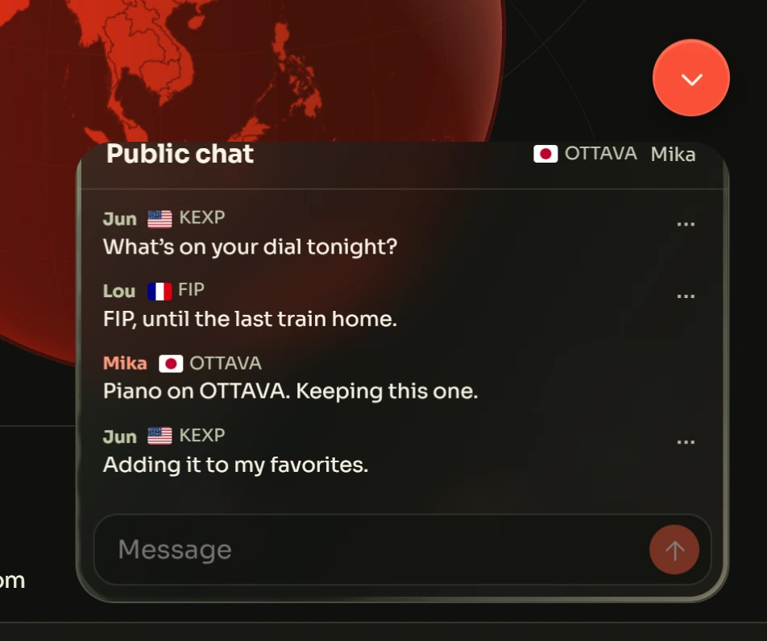

<h1 align="center"></h1>

<p align="center"><strong>Live radio from around the world, tuned by hand on your Windows desktop.</strong></p>

<p align="center">
  <a href="https://github.com/samueltoken/Allradione/releases/latest"><strong>Download for Windows ↗</strong></a>
  &nbsp; · &nbsp; <a href="https://github.com/samueltoken/Allradione/releases">Release notes</a>
  &nbsp; · &nbsp; <a href="https://github.com/samueltoken/Allradione/issues">Report an issue</a><br>
  <sub>Windows 10 or 11 · 64-bit · Open source</sub>
</p>

## Start with a place

Turn the globe to South Korea for MBC FM4U, or head to France for jazz on FIP. If you already know where you want to listen, search for the country by name. Save a station with the heart and it’s there the next time you open the app.



## Turn the dial

Drag the dial, scroll, or use the arrow keys to move between stations. A wide window gives MBC FM4U a sweeping scale and a dot-matrix display. In a smaller window, FIP Jazz sits beneath a round dial. Both displays move with the sound of the broadcast.

<p align="center">
  
  
</p>

Every country has tabs for **Official broadcasters**, **Independent radio**, **Unverified operator**, and **All**. Open the information button beside a station to see who runs it. When a separate operator relays the programme, the details distinguish the two and link to the available evidence.

<details>
<summary>See the broadcaster record for MBC FM4U</summary>



[How stations are classified](docs/station-classification.md) · [Operator sources](docs/network-operators.md)

</details>

## A radio that fits your desk

Leave OTTAVA playing while you work. The receiver widget puts the station, volume and playback controls within reach. The round widget pares it down to a pulse and a name. Drag either one smaller, or close the main window and keep listening from the Windows tray with **Background playback** enabled.



## What’s on your dial?

Open the red chat button from the globe or any country’s station list. The room is shared across stations. Your nickname, station and its country flag appear together, so someone listening in Japan can discover what a listener in France has on.

<p align="center"></p>
<p align="center"><sub>Illustrative conversation in the Allradione chat window.</sub></p>

## Install & update

1. Download `Allradione-Setup-<version>-x64.exe` from the [latest release](https://github.com/samueltoken/Allradione/releases/latest).
2. Run Setup, open **Allradione** from the desktop or Start menu, and choose a country and station. All you need to listen is an internet connection.
3. For later releases, open **Settings → Check for updates → Download and install**. From 0.2.5 onward this opens Windows Setup. You can cancel at the welcome screen and keep listening, or finish the installation and choose whether to reopen the app. Your favorites, recent stations and settings carry over.

In **Settings**, choose 한국어, English, 日本語, 简体中文, 廣東話, 臺灣華語, 臺灣台語 or Latina. You can also set a sleep timer and reduce motion.

<details>
<summary><strong>Windows installation, migration &amp; cleanup</strong></summary>

- Setup installs for the current Windows user. The desktop launcher continues to work after updates. Choose **Quit** from the tray to exit Allradione.
- Updates verify the installer with SHA-256, replace obsolete app files, and clean up completed update downloads. **Settings → Cache** clears caches while keeping your preferences and favorites.
- Version 0.2.4 uses its original updater. If an older update closes the app before Setup finishes, run the latest installer over the existing copy.
- To import a portable installation, place Setup beside its `Allradione-data` folder before your first installation. Allradione imports the settings and favorites when there is no installed profile and leaves the portable copy in place.
- **Windows Settings → Apps → Installed apps → Allradione → Uninstall** removes the app, its launchers, and its own settings and caches. Desktop widgets may be covered by exclusive fullscreen games and Windows security screens.

</details>

<details>
<summary><strong>Station directory &amp; privacy</strong></summary>

[Radio Browser](https://www.radio-browser.info/) supplies the community directory. Allradione checks broadcaster records and published stream addresses to identify operators and correct country assignments. It also includes Korean channels with broadcaster-published addresses. Availability varies by broadcaster, network and region. The player streams audio through a protected local connection on your PC. Starting playback sends the station ID to Radio Browser’s public click counter.

Listening requires no account. Opening chat connects to Allradione’s Cloudflare service. Other participants can see your nickname, messages and current station while you listen. Folding chat disconnects you. Choose a nickname or keep the assigned Ano number. A local token restores that identity when you return. The room shows up to 80 messages from the last 24 hours. Use a message’s menu to hide its author or report it. Reports keep a copy of the reported message for moderation for up to 30 days.

</details>

<details>
<summary><strong>Development &amp; builds</strong></summary>

Use Node.js 22.12 or later.

```sh
npm ci
npm test
npm run build
npm start
```

For renderer development, run `npm run dev` and launch Electron with `ALLRADIONE_DEV_URL=http://localhost:5173`. Electron provides native widgets, desktop launchers and update installation. To build the Windows installer, install the Visual Studio C++ Build Tools and Windows SDK, then run `npm run dist:win`.

GitHub Actions checks audio, widgets, chat, installation, updates, preservation of user settings, and removal. Upgrade checks use the published v0.2.5 installer pinned by its SHA-256 hash. To publish a release, update the package version and lockfile, add release notes under `docs/releases/`, and push the matching `v<version>` tag. The release workflow publishes the installer and `SHA256SUMS.txt` after its checks pass.

</details>

---

[MIT License](LICENSE) · [Third-party notices](THIRD_PARTY_NOTICES.md)  
Station logos and broadcast content belong to their respective owners.
